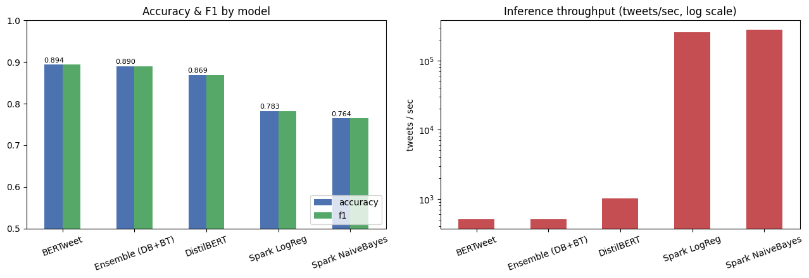
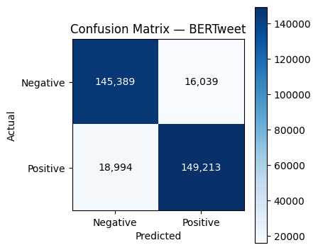
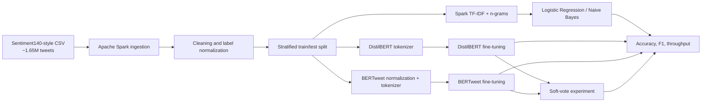

# BERTweet Sentiment Analysis at Big-Data Scale


An end-to-end sentiment-analysis benchmark that progresses from distributed Spark ML baselines to general and domain-adapted transformers on approximately 1.65 million tweets.

The project asks a practical engineering question: how much accuracy is gained by moving from bag-of-words models to contextual transformers, and what inference-throughput cost comes with that gain?

## Results

| Model | Accuracy | F1 | Inference throughput |
|---|---:|---:|---:|
| **BERTweet** | **0.8937** | **0.8937** | 513 tweets/s |
| DistilBERT + BERTweet soft vote | 0.8901 | 0.8901 | 513 tweets/s |
| DistilBERT | 0.8690 | 0.8690 | 1,022 tweets/s |
| Spark Logistic Regression | 0.7825 | 0.7822 | 254,507 tweets/s |
| Spark Naive Bayes | 0.7644 | 0.7644 | 277,621 tweets/s |

The saved run used 1,319,911 training tweets and 329,635 test tweets. BERTweet correctly classified 294,602 test examples and reached 89.37% accuracy, outperforming DistilBERT by 2.48 percentage points and Spark Logistic Regression by 11.12 points.





## What I built

- Loaded and cleaned approximately 1.65 million labeled tweets with Apache Spark.
- Created reproducible stratified train/test splits and label normalization.
- Built TF-IDF / n-gram Spark ML pipelines with Logistic Regression and Naive Bayes.
- Fine-tuned DistilBERT as a general contextual baseline.
- Fine-tuned `vinai/bertweet-base`, a model pretrained specifically on Twitter language.
- Preserved Twitter-specific signals through mention, URL, hashtag, and emoji-aware normalization.
- Compared accuracy, weighted F1, confusion matrices, and measured inference throughput.
- Tested a probability-level soft-voting ensemble without additional fine-tuning.
- Added live single-text inference with confidence and a review of representative errors.
- Documented the accuracy-versus-scalability trade-off rather than presenting accuracy alone.

## Why BERTweet won

BERTweet's pretraining domain matches the evaluation data. It has already learned representations for slang, mentions, hashtags, emoji, abbreviations, and non-standard punctuation. DistilBERT provides contextual language understanding but lacks that same Twitter-specific prior; the Spark models are much faster but discard word order and most contextual information.

The soft-vote ensemble did not exceed BERTweet in the saved run. That negative result is retained because it is useful: combining models is not automatically beneficial when one model is already better calibrated for the target domain.

## Pipeline



## Repository structure

```text
.
├── assets/
│   ├── sentiment_benchmark-01.png
│   └── sentiment_benchmark-02.png
├── notebooks/
│   └── sentiment_benchmark.ipynb
├── DATASET.md
├── requirements.txt
└── README.md
```

The raw dataset and trained model checkpoints are intentionally excluded because they are large and have separate distribution terms.

## Quick start

### Prerequisites

- Python 3.10+
- Java 17 for Spark
- CUDA-capable GPU recommended for transformer fine-tuning
- At least 16 GB RAM; the saved full-data run used an RTX 3080 Laptop GPU

```bash
python -m venv .venv
# Windows
.venv\Scripts\activate
# macOS/Linux
source .venv/bin/activate

python -m pip install --upgrade pip
pip install -r requirements.txt
jupyter lab notebooks/sentiment_benchmark.ipynb
```

Place the dataset at `data/sentiment140.csv`, or update `DATA_PATH` in the configuration cell. For a fast smoke test, set `SAMPLE_ROWS`, `TRAIN_SIZE`, and `TEST_SIZE` to smaller values before running the notebook.

## Saved experiment configuration

| Parameter | Value |
|---|---:|
| Transformer epochs | 1 |
| Maximum sequence length | 96 |
| Training batch size | 32 |
| Learning rate | 2e-5 |
| Warmup ratio | 0.1 |
| Weight decay | 0.01 |
| Spark version | 3.5.1 |

## Error analysis and limitations

The dataset labels are derived from emoticons, so they contain ambiguity and noise. Sarcasm, mixed sentiment, quoted speech, and context-dependent posts remain difficult. The benchmark is binary English sentiment and should not be generalized to multilingual, neutral, or fine-grained emotion tasks without further evaluation.

Throughput measurements are hardware- and batch-dependent. They are included to expose the deployment trade-off, not as universal performance claims.

## Skills demonstrated

Distributed data processing, Spark MLlib, transformer fine-tuning, domain adaptation, GPU training, experiment design, model evaluation, inference benchmarking, error analysis, and reproducible notebook engineering.

